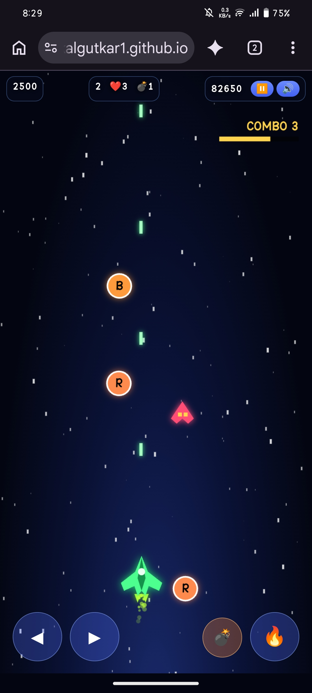

# 🚀 Space Defender

A space shooter game where you defend against waves of enemies. Currently in **Alpha V3**.

▶️ **[Play it in your browser](https://rohitkalgutkar1.github.io/Spacedefender/)**

📱 Android version: [Space-defender](https://github.com/Rohitkalgutkar1/Space-defender)

## 📸 Screenshots

## 🎮 How to play

- **Move:** [e.g. drag your finger / arrow keys]
- **Shoot:** [e.g. auto-fire / tap / spacebar]
- **Goal:** [e.g. survive as long as you can and beat your high score]

## ✨ Features

- [Feature 1, e.g. multiple enemy types]
- [Feature 2, e.g. score tracking]
- [Feature 3]

## 🛠️ Built with

[e.g. HTML, CSS, JavaScript]

## 🗺️ Roadmap

- [ ] [Next thing you want to add]
- [ ] [Another idea]

## 🐞 Feedback

Found a bug or have an idea? Open an [issue](https://github.com/Rohitkalgutkar1/Spacedefender/issues).
